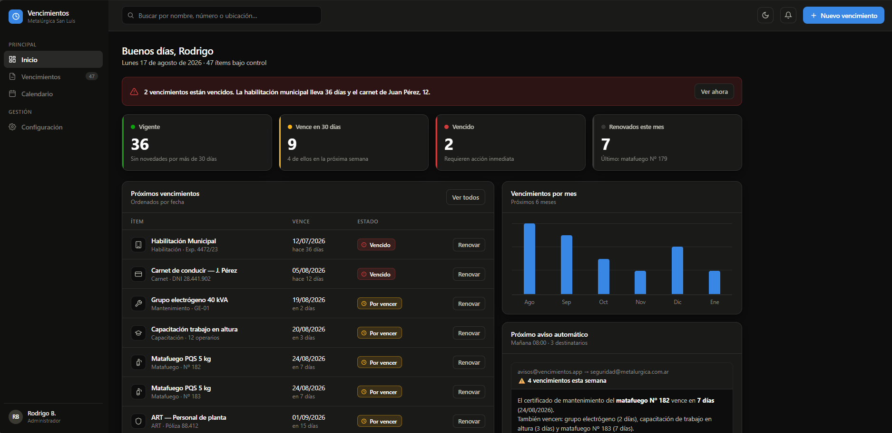
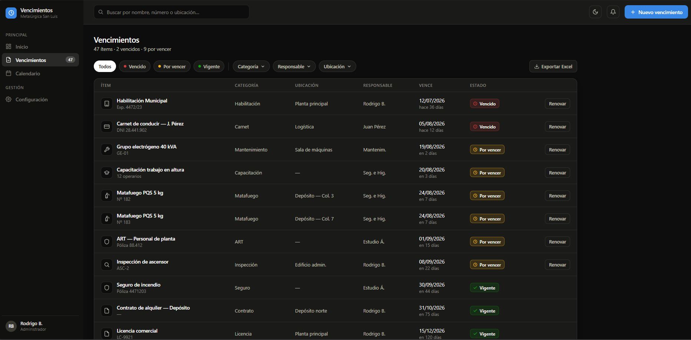
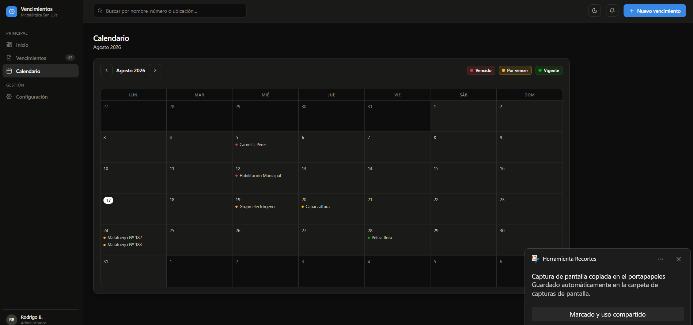
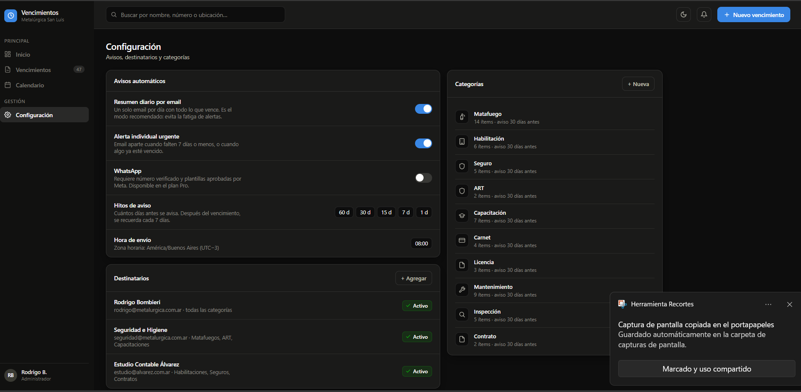
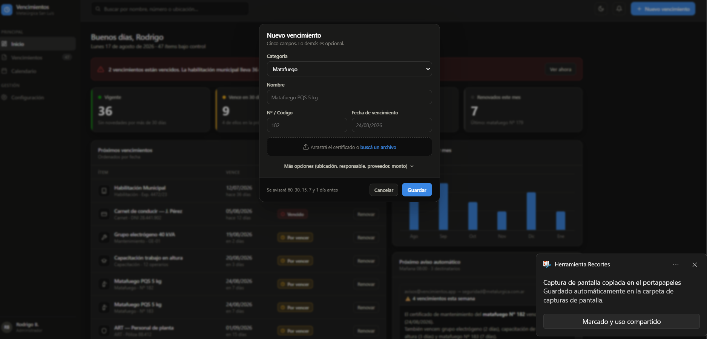

# Control de Vencimientos

Aplicación web para que pequeñas y medianas empresas controlen los vencimientos de habilitaciones, seguros, matafuegos, ART, capacitaciones, carnets, licencias, mantenimientos, inspecciones, contratos y cualquier otro trámite con fecha de expiración — con semáforo de estado, calendario, avisos automáticos por email y multiempresa desde el diseño.

## Capturas

<table>
  <tr>
    <td></td>
    <td></td>
  </tr>
  <tr>
    <td></td>
    <td></td>
  </tr>
  <tr>
    <td colspan="2"></td>
  </tr>
</table>

## Funcionalidades

- **Dashboard** con semáforo de estado (vigente / por vencer / vencido), gráfico de vencimientos por mes, próximos vencimientos y renovaciones del mes.
- **Listado y calendario** de vencimientos, con filtros, paginación y navegación mensual.
- **Alta, edición, renovación y anulación** de vencimientos, con historial (renovar crea un nuevo registro y conserva el anterior).
- **Adjuntos** por vencimiento (PDF/imagen), servidos siempre autenticados, nunca por URL directa.
- **Categorías configurables** con ícono a elección entre un preset de emojis, y días de aviso por defecto.
- **Avisos automáticos por email**, con hitos configurables (90/60/45/30/15/7/3/1/0 días), digest y alertas individuales para lo urgente, y destinatarios filtrables por categoría.
- **Multiempresa desde el diseño**, con aislamiento de datos por empresa vía query filters globales.
- **Tema claro/oscuro**, guardado por navegador.

## Stack técnico

- **.NET 10** / ASP.NET Core MVC
- **Entity Framework Core 10** sobre **SQL Server**
- **ASP.NET Core Identity** para autenticación y roles
- **Hangfire** para el job recurrente que dispara los avisos por email
- **Serilog** para logging
- xUnit para tests, sin base de datos: la lógica de negocio (cálculo de semáforo, armado de avisos, de listados, de calendario, de mails) vive en clases estáticas puras, separadas de los controllers

## Arquitectura

El proyecto sigue un enfoque de *functional core, imperative shell*: toda la lógica de negocio (cálculo de estado, reglas de avisos, armado de listados/calendario/dashboard, armado de los mails) está en servicios estáticos sin dependencias externas, cubiertos por tests unitarios. Los controllers y los jobs quedan finos, como cableado entre esa lógica y la base de datos / la vista.

El aislamiento multiempresa se resuelve con un `EmpresaId` en cada entidad y query filters globales de EF Core aplicados por reflexión — agregar una entidad nueva al modelo multiempresa es tan simple como implementar una interfaz marcador, sin tocar cada consulta a mano.

## Cómo correrlo localmente

1. Clonar el repositorio y abrir `ControlVencimientosS/ControlVencimientosS.slnx` en Visual Studio.
2. Configurar la cadena de conexión a SQL Server / LocalDB (`appsettings.json` o User Secrets).
3. Aplicar las migraciones (`Update-Database` desde la Consola del Administrador de Paquetes).
4. *(Opcional)* Cargar datos de ejemplo corriendo `Data/Seed_DatosDeEjemplo.sql` a mano contra la base.
5. *(Opcional)* Para probar el envío real de avisos por email, cargar credenciales SMTP propias con `dotnet user-secrets set "Smtp:Host" "..."` (y `Smtp:Usuario`, `Smtp:Password`, `Smtp:RemitenteEmail`) — sin esto, la app funciona igual, simplemente no llegan a enviarse los mails.
6. Ejecutar el proyecto (`F5`).

## Estado

Proyecto de portfolio en desarrollo activo, sin datos reales cargados todavía.
